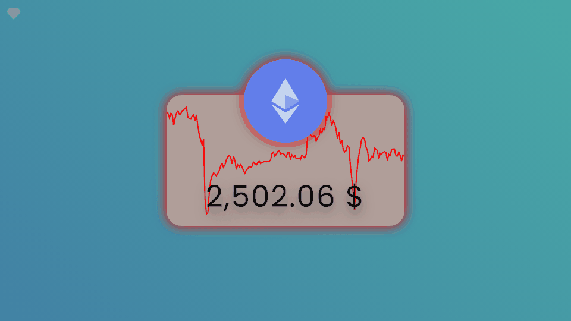
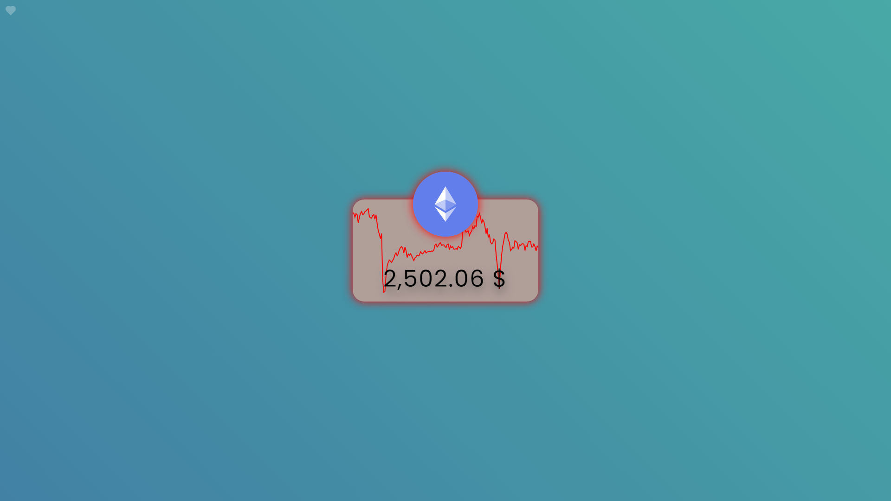
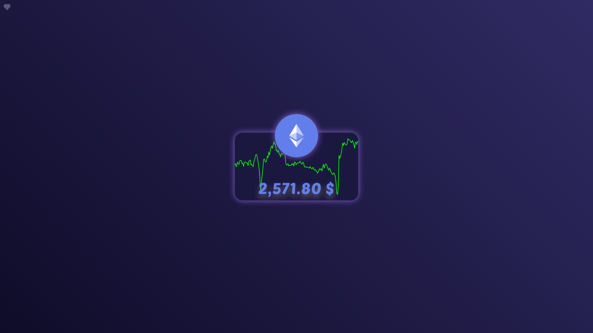
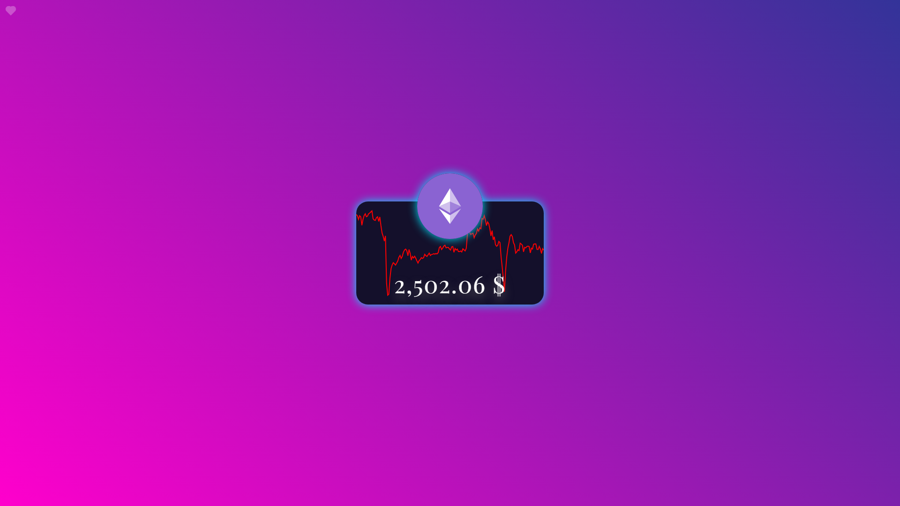
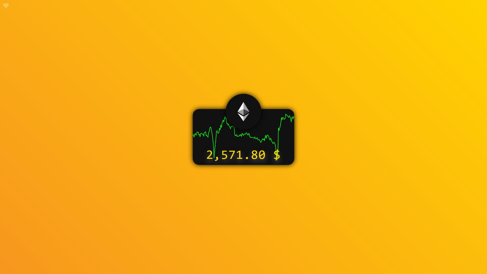
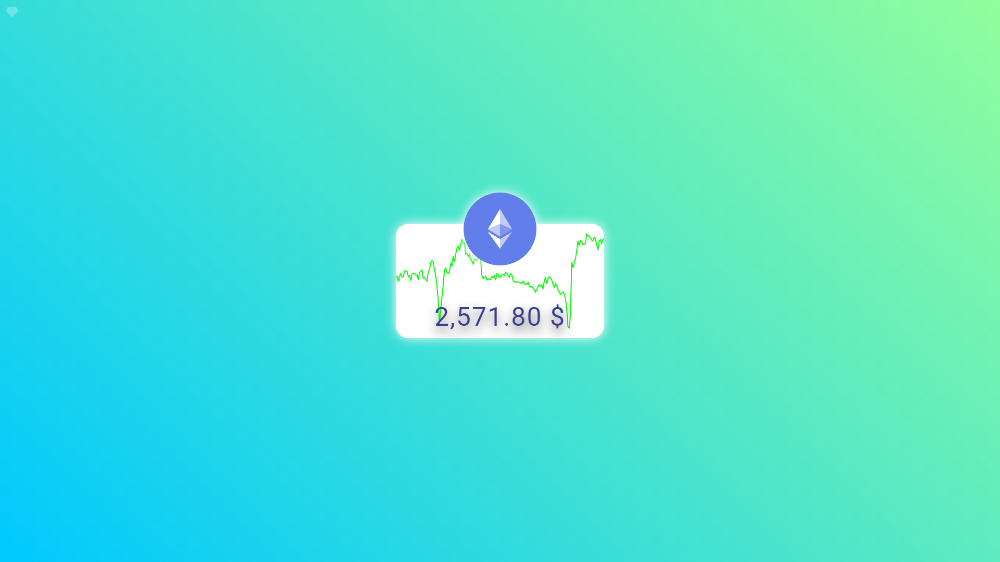
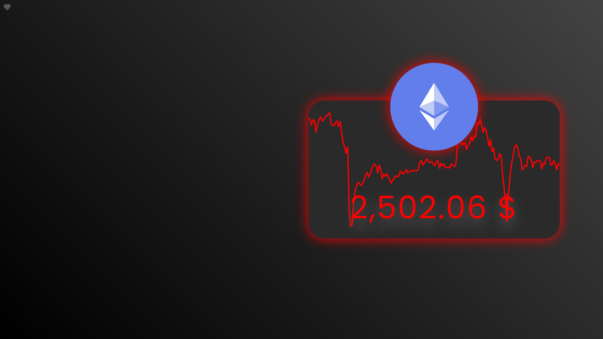
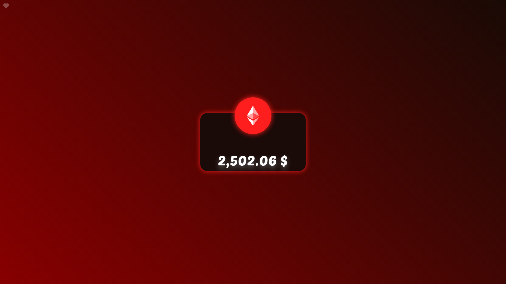
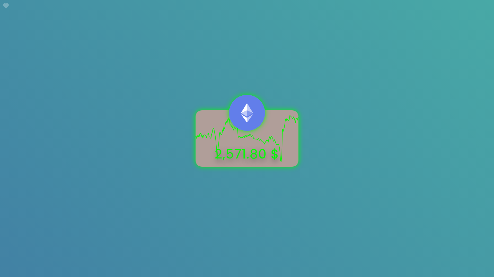
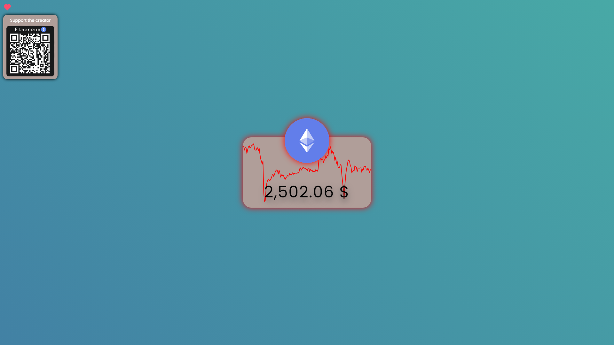

# Ethereum Price Tracker for Wallpaper Engine
A dynamic wallpaper for Wallpaper Engine that displays the current price of Ethereum (USD) and a 7-day price chart. The appearance can be customized directly in the Wallpaper Engine properties panel.
- [Project on Steam](https://steamcommunity.com/sharedfiles/filedetails/?id=3252688975)
- [Project example](https://cv0x.github.io/Ethereum-Price-Tracker/)

  

## Description

This project creates a customizable wallpaper for the [Wallpaper Engine](https://store.steampowered.com/app/431960/Wallpaper_Engine/) program, displaying the real-time Ethereum (ETH) price in USD and a 7-day price chart. Data is loaded from the [CoinGecko API](https://www.coingecko.com/en/api) every 60 seconds and the chart is drawn from its 7-day sparkline data.

## How it works

The wallpaper is a plain web page (HTML, CSS and JavaScript, no build step) that Wallpaper Engine runs as a **Web wallpaper**.

1. **Data** – [app.js](app.js) calls the CoinGecko `/coins/ethereum` endpoint with `sparkline=true` on load and then every 60 seconds. One response contains both the current USD price and hourly prices for the last 7 days.
2. **Price** – the USD price is formatted (`2,502.06 $`) and the font size automatically shrinks until the text fits inside the card, so longer prices or wider fonts never overflow.
3. **Chart** – the 7-day hourly prices are scaled to the card size and drawn as an SVG polyline behind the price. The line is green when the last price is higher than the first one (uptrend) and red when it is lower (downtrend).
4. **Interactive color** – the same trend color can be used for the price text and for the glow around the logo and card, so the whole wallpaper reflects the market at a glance.
5. **Settings** – [project.json](project.json) describes the user properties shown in the Wallpaper Engine properties panel. Wallpaper Engine calls `window.wallpaperPropertyListener.applyUserProperties()` once on load with all values and then again with every change, so edits apply instantly without reloading. Colors arrive in Wallpaper Engine format (`"0.38 0.49 0.92"`) and are converted to CSS `rgb()`.
6. **Styling** – settings are applied as CSS variables (`--main-color`, `--eth-color`, `--bg-color-1`, `--bg-color-2`, `--scale`, `--offset-x`, `--offset-y`) used in [style.css](style.css). The Ethereum logo is an inline SVG, so its color can be changed too.
7. **Browser fallback** – outside Wallpaper Engine the page uses the default settings from `app.js`, which is how the [live demo](https://cv0x.github.io/Ethereum-Price-Tracker/) works.

### Project structure

| File | Purpose |
|---|---|
| [index.html](index.html) | Card, SVG logo, price, chart and the support-the-creator box |
| [style.css](style.css) | Layout, fonts and CSS variables controlled by the settings |
| [app.js](app.js) | Data fetching, chart drawing, price fitting and Wallpaper Engine property listener |
| [project.json](project.json) | Wallpaper Engine project file with all user properties |
| [preview.gif](preview.gif) | 256×256 preview shown in Wallpaper Engine and on the Workshop |
| [screenshots/](screenshots) | Screenshots and the 16:9 demo GIF used in this README |

## Usage

1. Log in to Steam in your browser.
2. Subscribe to this [ETHEREUM WALLPAPER](https://steamcommunity.com/sharedfiles/filedetails/?id=3252688975).
3. Open Wallpaper Engine and select the wallpaper in the Installed tab.
4. Customize it in the properties panel on the right side of Wallpaper Engine (changes apply instantly).

## Customization Options

All options are defined in [project.json](project.json) as Wallpaper Engine user properties and are received in [app.js](app.js) via `window.wallpaperPropertyListener`.

| Property | Options | Default |
|---|---|---|
| Font | Poppins, Roboto, Playfair, Poetsen, Cursive, Sans-serif, Monospace | Poppins |
| Price color | Custom color, Interactive (7d trend), Ethereum color presets | Custom color (black) |
| Logo & card shadow | Off, Custom color, Interactive (7d trend), Ethereum color presets | Interactive |
| Logo color | Any color | Ethereum blue |
| Card color | Any color | Light brown |
| Background | Gradient presets, Custom colors | Ocean Teal |
| Background color 1 / 2 | Any color (only with Custom colors) | Blue / teal |
| Show 7-day chart | On / Off | On |
| Size | 50 – 250 % | 100 % |
| Horizontal / vertical position | -45 – 45 % of the screen | 0 (center) |

| Ethereum Night | Cosmic Fusion |
|---|---|
|  |  |
| **Gwei Gold** | **Aurora** |
|  |  |
| **Size 200 % moved to the right** | **Chart off** |
|  |  |

### Ethereum color presets
Ethereum Blue, Ether Indigo, Merge Purple, Diamond Silver, Gwei Gold, Gas Fee Red, Staking Green, Smart Contract Cyan, Ultrasound Orange, Whitepaper White, Cold Wallet Black.

### Background gradient presets
Ocean Teal, Ethereum Night, Merge Purple, Cosmic Fusion, Sunset, Aurora, Royal Blue, Crimson Night, Gwei Gold, Mint Forest, Deep Space.

### Interactive color
Price color and shadow can follow the 7-day trend. They use the same color as the chart line: green when the price is higher than 7 days ago, red when it is lower.

| Downtrend | Uptrend |
|---|---|
|  |  |

## Support the creator
Hover over the small heart in the top left corner to show the ETH QR code.

